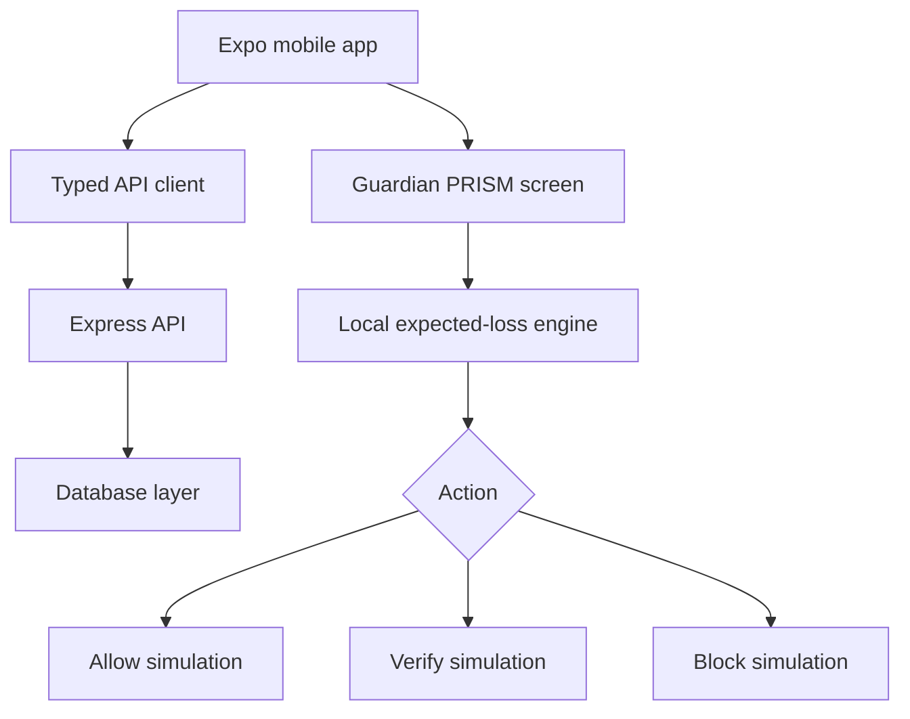

# نبيهه | NABEEHA ✦

### Intelligent Digital Banking Experience · تجربة مصرفية ذكية

> **Nabeeha** is a cross-platform financial experience prototype bringing together personal banking dashboards, financial insights, digital contracts, and a bilingual Guardian PRISM risk-decision laboratory.

**نبيهه** تجربة تطبيق مالي على الجوال، تتضمن واجهات لإدارة الأصول والبطاقات، ووحدة حماية ذكية تجريبية بالعربي والإنجليزي.

> [!IMPORTANT]
> **Research/demo software only.** No live payments, regulated banking activities, validated fraud detection rates, or production security guarantees are provided.

## Features | المميزات

| Area | Included | Maturity |
|---|---|---|
| Mobile experience | Expo / React Native dashboard, profiles, cards, insights | Original application prototype |
| API architecture | Express/TypeScript service, typed clients | Original prototype |
| **Guardian PRISM** | Bilingual AR/EN interactive risk evaluation | Added functional demo |
| **Cost-aware response** | Allow / verify / block with expected-loss explanation | Added, modelled |
| **Threat mixture** | Password theft + session theft + social engineering | Added, simulated |
| **Evidence-aware wait** | Value of waiting, evidence qualification | Added, simulated |
| Testing | T01–T14 for Guardian PRISM mathematical engine | 14 passing locally |
| Research materials | Six-page PDF, roadmap, security disclosure | Included |

## Architecture



## Run locally | التشغيل

Requirements: Node.js 22+, pnpm, and dependencies appropriate for Expo development.

```bash
pnpm install
pnpm --filter @workspace/mobile dev
```

If workspace names differ, consult `artifacts/mobile/package.json` for package scripts. The original API may require a configured database and environment variables. **Never commit secrets or real customer data.**

### Guardian PRISM tests

```bash
node --test tests/guardian-prism.test.mjs
```

Inside the app: **Profile → Guardian PRISM · الأمان الذكي**. Press **EN / عربي** in the top bar to switch the new security panel language.

## Research report

See [PROJECT_REPORT.pdf](PROJECT_REPORT.pdf) for a six-page project narrative covering assumptions, features, test evidence, limits, and the roadmap.

Read [PROJECT_SCOPE.md](PROJECT_SCOPE.md) for implementation boundaries and [SECURITY.md](SECURITY.md) before experimental deployment.

## Responsible claims | حدود الادعاءات

- The original app includes English-language screens; **full bilingual coverage is not complete**. The new PRISM screen is bilingual.
- The 14 tests are unit tests of the new risk engine, **not a security audit** of the banking application.
- Probabilities, attacker types, and SAR costs are assumed demonstration values.
- Passkey/WebAuthn integration and real transaction enforcement are future roadmap items.

## Technology

React Native · Expo Router · TypeScript · Express · pnpm monorepo · OpenAPI · Drizzle · Node.js tests

---

**Nabeeha — designed for informed, safer digital decisions.**
